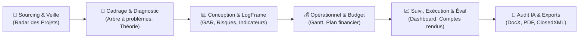
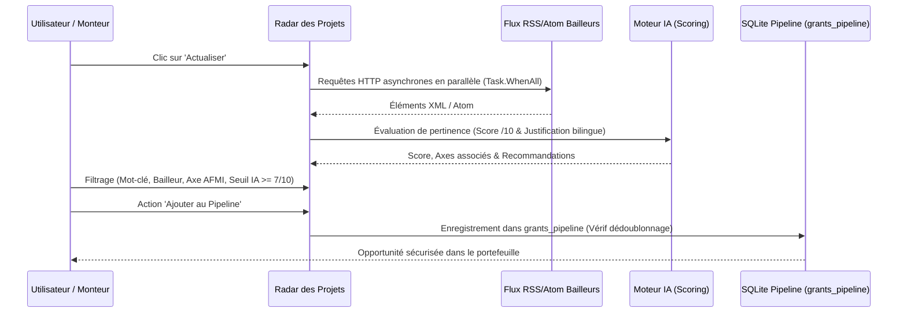
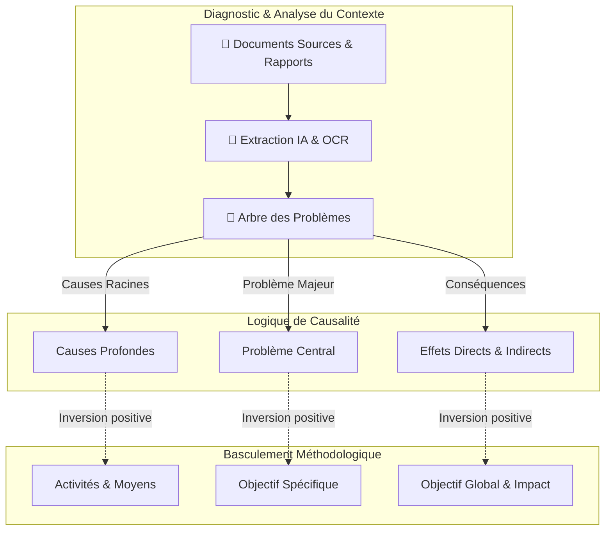
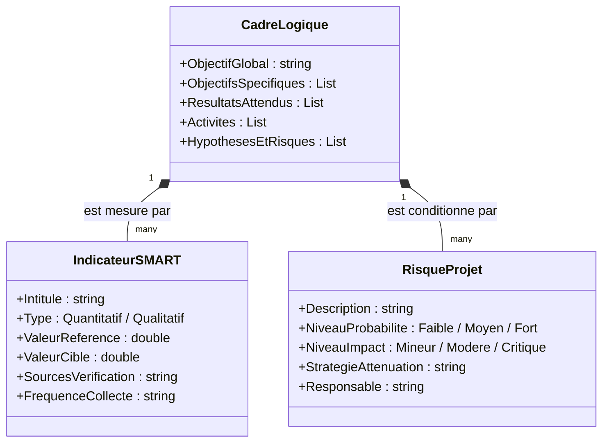
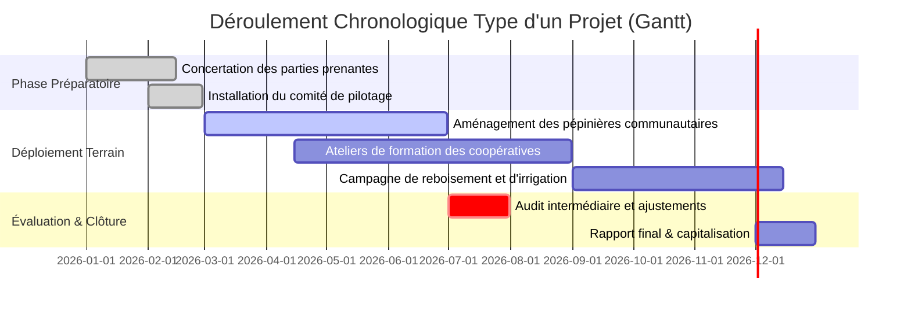
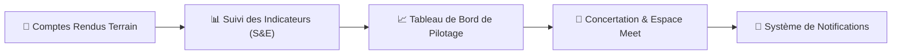
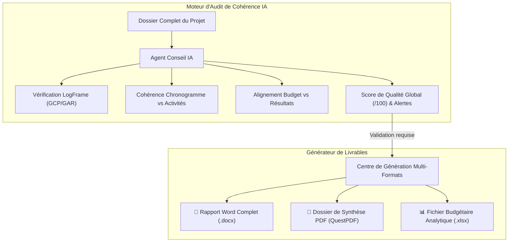

# Catalogue Fonctionnel Détaillé & Guide Méthodologique
## Plateforme AFMI Montage Projet — Version 1.9.16

---

## 1. Introduction & Vision Stratégique

### 1.1 Présentation Générale
**AFMI Montage Projet** est une plateforme logicielle professionnelle conçue sur mesure pour l'ingénierie, la modélisation, le pilotage et le plaidoyer de projets de développement durable, d'action sociale et de préservation environnementale. 

Développée en **C# 13, .NET 9 (WPF)** avec une architecture hautement sécurisée (EF Core 9, SQLite local, PostgreSQL distant, DPAPI, isolation hors-ligne), l'application intègre des moteurs d'intelligence artificielle locale et hybride pour accompagner les acteurs associatifs et institutionnels tout au long de la chaîne de valeur du projet.



### 1.2 Alignement Méthodologique
Le logiciel est bâti sur les deux piliers internationaux de la coopération au développement :
1. **La Gestion du Cycle de Projet (GCP / PCM - Project Cycle Management)** promue par l'Union Européenne, la Banque Mondiale et les agences des Nations Unies.
2. **La Gestion Axée sur les Résultats (GAR / RBM - Results-Based Management)** garantissant une causalité rigoureuse entre intrants, activités, extrants, effets directs et impact à long terme.

---

## 2. Architecture Globale & Navigation

### 2.1 Schéma Fonctionnel de la Barre Latérale
La barre latérale du logiciel a été ordonnée selon une logique séquentielle rigoureuse :

```mermaid
graph TD
    subgraph Sourcing [" PHASE 0 : VEILLE & SOURCING "]
        M0["📡 Radar des Projets (Opportunités & Bailleurs)"]
    end

    subgraph Phase1 [" PHASE 1 : CADRAGE & DIAGNOSTIC "]
        M1["🧭 Planification Stratégique & Théorie du Changement"]
        M2["📋 Fiche de Cadrage du Projet"]
        M3["🌳 Arbre de Problèmes & d'Objectifs"]
        M4["📄 Analyse de Documents (OCR & Extraction IA)"]
        M5["📋 Formulaire Sectoriel Dynamique"]
    end

    subgraph Phase2 [" PHASE 2 : CONCEPTION & CADRE LOGIQUE (GAR) "]
        M6["📊 Cadre Logique (LogFrame standard)"]
        M7["🎯 Indicateurs de Suivi SMART"]
        M8["⚠️ Gestion des Risques & Hypothèses"]
    end

    subgraph Phase3 [" PHASE 3 : PROGRAMMATION OPÉRATIONNELLE & BUDGET "]
        M9["📅 Chronogramme d'Activités (Gantt interactif)"]
        M10["💰 Budget Prévisionnel Analytique"]
    end

    subgraph Phase4 [" PHASE 4 : SUIVI, EXÉCUTION & COORDINATION "]
        M11["📅 Plan de Suivi & Évaluation (Jalons S&E)"]
        M12["📈 Tableau de Bord & Métriques"]
        M13["📝 Comptes Rendus d'Activités & Visites"]
        M14["🤝 Espace Collaboratif & Réunions (Meet)"]
    end

    subgraph Phase5 [" PHASE 5 : REVUE, AUDIT & CLÔTURE "]
        M15["🤖 Agent Conseil IA (Audit Méthodologique)"]
        M16["📤 Génération & Exports (Word, PDF, Excel)"]
    end

    subgraph Phase6 [" OUTILS TRANSVERSES & ADMINISTRATION "]
        M17["📥 Boîte de Réception des Validations"]
        M18["⚙️ Paramètres Généraux"]
        M19["☁️ Paramètres Cloud & Synchronisation"]
        M20["💬 Assistant IA Chat Omniprésent"]
    end

    Sourcing --> Phase1
    Phase1 --> Phase2
    Phase2 --> Phase3
    Phase3 --> Phase4
    Phase4 --> Phase5
    Phase5 --> Phase6
```



---

## 3. Phase 0 : Sourcing & Veille Stratégique — Le Radar des Projets

Le **Radar des Projets** est le centre de détection précoce des subventions et appels à projets émis par les bailleurs de fonds (GEF, PNUD, Union Européenne, AFD, Banque Mondiale, CEPF, etc.).



### 3.1 Fonctionnalités Clés du Radar
* **Interrogation Parallèle Asynchrone** : Téléchargement simultané de dizaines de flux RSS sans aucun blocage de l'interface utilisateur, avec barre de progression et statut par source.
* **Recherche Intelligente Normalisée** : Moteur de recherche tolérant insensible aux diacritiques arabes (suppression du tachkeel, unification des hamzas `أ/إ/آ -> ا`) et français (accents `é/è/ê -> e`).
* **Puces Thématiques Rapides (Chips)** : Filtres en un clic pour les thématiques stratégiques de l'AFMI (Biodiversité, Cèdre de l'Atlas, Eau, Tourisme Durable, Économie Sociale, Jeunesse).
* **Évaluation d'Adéquation IA** : Calcul automatique d'un score d'affinité territorial (0 à 10) et identification des axes stratégiques ciblés.
* **Pipeline des Subventions** : Tableau de bord de suivi des soumissions avec dates limites, budgets prévisionnels et statuts (`Identifié`, `En rédaction`, `Soumis`, `Accordé`).

```
+---------------------------------------------------------------------------------------------------------+
| RADAR DES PROJETS                                                [🔄 Actualiser tout]  [⚙️ Config Axes]  |
+---------------------------------------------------------------------------------------------------------+
| [🔍 Recherche libre...]  (Cèdre) (Forêt) (Eau) (Coopérative) (Femmes) (Biodiversité)                  |
| Filtres : [Bailleurs: Tous ▼] [Axe AFMI: Tous ▼] [Score IA: >= 7/10 ▼]   [❌ Effacer tout]              |
+---------------------------------------------------------------------------------------------------------+
| [Onglet: Opportunités Détectées (24)]  |  [Onglet: Pipeline (5)]  |  [Onglet: Sources & Flux (12)]      |
+---------------------------------------------------------------------------------------------------------+
|  🌱 Appel à projets : Conservation du Cèdre et Adaptation au Changement Climatique                       |
|  Bailleur: GEF / PNUD | Date limite: 30/11/2026 | Budget estimé: 150 000 $                                |
|  Score IA: [🟢 8.7/10 - Excellente Adéquation] | Axes: Axe 1 (Forêt & Cèdre), Axe 4 (Gestion de l'Eau)   |
|  Résumé: Financement d'initiatives communautaires pour la régénération du couvert forestier...           |
|  [📥 Ajouter au Pipeline]   [✨ Rédiger le Projet (IA)]   [🌐 Ouvrir le Lien]                            |
+---------------------------------------------------------------------------------------------------------+
```

---

## 4. Phase 1 : Cadrage & Diagnostic Territorial

Cette phase établit les fondations méthodologiques du projet en s'assurant que l'intervention répond à des besoins réels, validés et mesurables.



### 4.1 Modules de la Phase 1
* **🧭 Planification Stratégique** : Modélisation visuelle de la Théorie du Changement (ToC), reliant les hypothèses initiales aux transformations territoriales souhaitées.
* **📋 Fiche de Cadrage** : Fiche signalétique complète du projet (titre, acronyme, zone géographique, durée, population cible, chefs de file et partenaires).
* **🌳 Arbre des Problèmes & Objectifs** : Constructeur graphique permettant d'organiser les relations de cause à effet. L'inversion automatique transforme l'arbre des problèmes en arbre des solutions.
* **📄 Analyse de Documents & OCR** : Lecteur intelligent capable d'ingérer des rapports d'études préalables, monographies territoriales et diagnostics associatifs (PDF/Word), avec extraction synthétique assistée par IA.
* **📋 Formulaire Sectoriel Dynamique** : Questionnaires adaptatifs configurables selon la thématique (développement rural, valorisation artisanale, gestion hydrique).

---

## 5. Phase 2 : Conception Méthodologique & Cadre Logique (GAR)

Le cœur de la modélisation du projet repose sur la **Matrice du Cadre Logique**, référence incontournable de tous les bailleurs internationaux.



### 5.1 Éléments Fondamentaux de la Matrice
1. **Objectif Global (Impact)** : Contribution du projet à une politique publique ou à un enjeu territorial supérieur.
2. **Objectifs Spécifiques (Effets directs / Outcomes)** : Changements durables et bénéfices concrets générés au niveau des populations cibles.
3. **Résultats Attendus (Extrants / Outputs)** : Produits, biens tangibles et services délivrés par la mise en œuvre des activités.
4. **Activités (Intrants / Inputs)** : Actions opérationnelles coordonnées mobilisant des ressources humaines, matérielles et financières.
5. **Indicateurs SMART & Risques** : Chaque niveau est associé à des indicateurs Spécifiques, Mesurables, Atteignables, Réalistes et Temporellement définis, assortis de leurs sources de vérification.

---

## 6. Phase 3 : Programmation Opérationnelle & Budget



### 6.1 Chronogramme d'Activités (Gantt)
* **Planification Mensuelle et Trimestrielle** : Affectation des activités avec barres d'avancement dynamiques.
* **Liaisons de Dépendance** : Gestion des antécédents opérationnels pour éviter les incohérences de calendrier.
* **Identification des Jalons Clés** : Marqueurs critiques pour les comités de pilotage et échéances bailleurs.

### 6.2 Budget Prévisionnel Analytique
* **Ventilation par Rubriques Standard** : Ressources humaines, équipements, frais de mission, activités de terrain, communication, frais de gestion administrative.
* **Financement Multi-Partenaires** : Calcul automatique des pourcentages de contribution (Bailleur principal, Co-bailleurs, Apport propre de l'association, Contribution valorisée des bénéficiaires).
* **Contrôles de Plafonds Automatiques** : Alerte en cas de dépassement des règles bailleurs (ex: frais administratifs > 7%).

---

## 7. Phase 4 : Mise en Œuvre, Suivi & Coordination



### 7.1 Tableau de Bord (Dashboard)
* **Indicateurs de Performance en Temps Réel** : Taux d'avancement physique vs taux d'exécution budgétaire.
* **Courbes d'Atteinte des Cibles** : Graphiques d'évolution des bénéficiaires touchés (hommes, femmes, jeunes).
* **Indicateurs d'Alerte** : Détection automatique des retards sur le calendrier critique.

### 7.2 Comptes Rendus & Espace Collaboratif
* **Fiches d'Activités Terrains** : Saisie standardisée des réalisations, photos, feuilles de présence et pièces justificatives.
* **Espace Collaboratif Intégré (Meet)** : Planification des revues trimestrielles, partage des ordres du jour et validation collective des PV.

---

## 8. Phase 5 : Revue Qualité, Audit IA & Génération de Dossiers



### 8.1 L'Agent Conseil IA
L'Agent Conseil IA agit comme un évaluateur externe indépendant :
* **Détection des Ruptures de Logique** : Signale si une activité ne contribue à aucun résultat attendu, ou si un résultat attendu est orphelin d'indicateur SMART.
* **Contrôle de Rigueur Budgétaire** : Identifie les lignes de coûts sous-estimées ou non justifiées dans le narratif.
* **Rapport de Recommandations** : Fournit une liste priorisée d'améliorations rédactionnelles et techniques avant le dépôt du dossier.

### 8.2 Moteurs d'Exportation Professionnels
* **Export Word (DocX)** : Dossier complet de soumission mis en page selon la charte institutionnelle, incluant pages de garde, tables des matières, tableaux matriciels et signatures.
* **Export PDF Haute Définition (QuestPDF)** : Fiche de projet exécutive et infographies synthétiques vectorielles.
* **Export Excel (ClosedXML)** : Matrice financière dynamique avec formules automatiques de calcul.

---

## 9. Outils Transverses : L'Intelligence Artificielle Omniprésente

### 9.1 L'Adorner IA Contextuel
Chaque champ de saisie textuel majeur de l'application est équipé d'une icône d'assistance IA discrète et élégante (`✨ IA`), permettant d'interagir immédiatement avec le texte sans quitter la vue active :

```
+---------------------------------------------------------------------------------------------------------+
| [Contexte & Justification du Projet]                                                            [✨ IA] |
|                                                                                                         |
| La zone de l'Atlas central connaît une dégradation notable des ressources en eau due aux sécheresses... |
+---------------------------------------------------------------------------------------------------------+
       |
       v (Clic sur ✨ IA)
+---------------------------------------------------------------------------------------------------------+
| ✨ Assistant de Rédaction et Amélioration de Texte                                                      |
+---------------------------------------------------------------------------------------------------------+
| Actions rapides :                                                                                       |
| [🔄 Reformuler en style institutionnel]  [🔍 Corriger orthographe & grammaire]  [🌐 Traduire Ar/Fr]     |
| [🎯 Rendre plus convaincant (Bailleurs)]   [✂️ Raccourcir / Résumer]              [➕ Développer]          |
|                                                                                                         |
| Proposition IA :                                                                                        |
| "Dans le contexte des stress hydriques récurrents affectant les écosystèmes du Moyen Atlas, le présent   |
| projet vise à mettre en œuvre un schéma résilient de gestion concertée des ressources aquifères..."     |
|                                                                                                         |
| [✅ Appliquer au champ]                                                      [❌ Annuler]               |
+---------------------------------------------------------------------------------------------------------+
```

### 9.2 Sécurité, Sauvegarde & Cloud
* **Chiffrement DPAPI (Data Protection API)** : Toutes les clés d'API (OpenAI, Gemini, Mistral) et informations d'authentification sont chiffrées au repos via les mécanismes natifs du système d'exploitation Windows.
* **Bases de Données Hybrides** : Fonctionnement autonome en SQLite pour les missions de terrain sans connexion internet, avec possibilité de synchronisation montante vers un serveur PostgreSQL d'organisation.
* **Sauvegarde Cloud Sécurisée** : Sauvegarde planifiée des bases et archives de projets sur Google Drive ou espace réseau sécurisé.

---

## 10. Synthèse & Bonnes Pratiques pour le Monteur de Projet

| Phase du Projet | Outil Clé AFMI | Facteur Clé de Succès auprès des Bailleurs |
| :--- | :--- | :--- |
| **0. Sourcing** | `Radar des Projets` | Anticiper les appels d'offres au moins 45 jours avant l'échéance. |
| **1. Diagnostic** | `Arbre de Problèmes` | Démontrer l'implication réelle des bénéficiaires et des communautés locales. |
| **2. Conception** | `Cadre Logique & Indicateurs` | Définir des indicateurs SMART réalistes assortis de moyens de preuve tangibles. |
| **3. Planification**| `Gantt & Budget Analytique` | Garantir la cohérence stricte entre durée d'activités et coûts unitaires. |
| **4. Exécution** | `Tableau de Bord & Comptes Rendus` | Maintenir une traçabilité documentaire continue pour les audits bailleurs. |
| **5. Clôture** | `Agent Conseil IA & Export` | Soumettre un dossier complet, vérifié sans fautes et sans rupture logique. |

---
*Catalogue fonctionnel établi pour la version 1.9.16 d'AFMI Montage Projet.*
